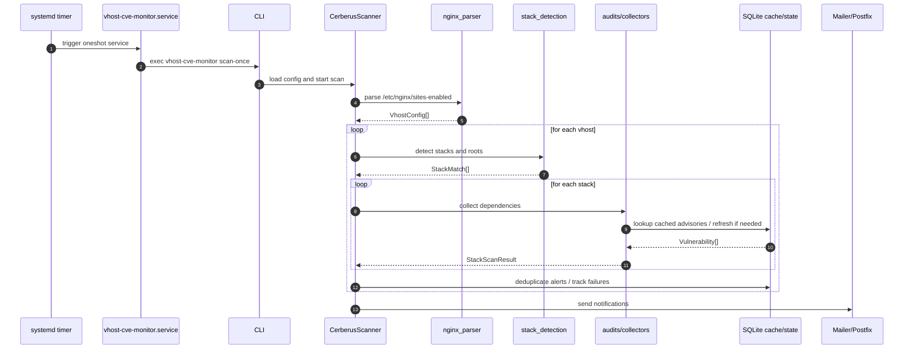
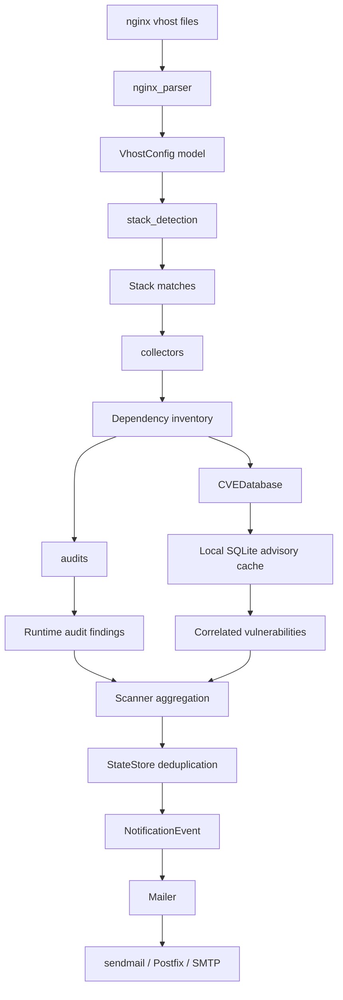

# Cerberus

## Overview

Cerberus is a maintainable Python 3 monitor for Debian servers that inspects nginx vhosts, detects the application stack behind each vhost, runs stack-specific security audits when possible, correlates detected versions with a local SQLite advisory cache, and sends email alerts only for new or materially changed findings.

This export document is intended for editable office formats such as DOCX. It is derived from the repository README and extended with architecture diagrams.

## Architecture Summary

- nginx_parser reads `/etc/nginx/sites-enabled`, resolves useful includes, and extracts server names, roots, and upstream hints.
- stack_detection applies explicit heuristics based on files and upstream names.
- collectors reads package manifests, lockfiles, local virtualenvs, and service version markers.
- audits runs optional ecosystem-native tools such as npm audit, `composer audit`, and `pip-audit`.
- npm scans run both `npm audit --omit=dev` and full `npm audit`, allowing Cerberus to separate production/runtime exposure from development/build dependency maintenance.
- loopback nginx `proxy_pass` targets can be correlated with local listening processes through `/proc` to infer bounded project roots when enough filesystem evidence is available.
- cve_db maintains a local SQLite advisory cache fed by targeted OSV queries.
- state_store prevents alert spam by tracking previously sent findings and repeated failures.
- notify delivers alerts through local sendmail, plain SMTP, STARTTLS SMTP, or authenticated SMTPS/SMTP.
- scanner orchestrates the full scan cycle.
- codex_analysis optionally enriches findings with bounded AI-assisted static triage through Codex CLI. It is disabled by default and never replaces scanner severity.

## Runtime CVE checks

Application dependency audits and interpreter audits are separate. The runtime
adapter identifies PHP, Node.js and Python through local backend processes or
explicit bindings. Debian source revisions preserve backport semantics; upstream
matches with unknown distributor status remain explicitly provisional. CPython
uses the PSF OSV advisory database through an official release-tag commit query;
matching PSF/CVE records are merged and cached by runtime version. Official
repository feeds are not exhaustive and incomplete coverage is reported.

`runtime_audit.enabled` defaults to `true`; `codex_analysis.enabled` remains
`false` in public configuration. Local opt-in is preserved. Codex can contextualize
runtime findings but cannot change official severity or certify live exposure.
Exports and mails retain runtime provenance and all affected targets.
See [Runtime CVE coverage and optional AI triage](RUNTIME_AUDIT.md) for configuration,
security boundaries, cache behavior and the additive database migration.

## Runtime Flow

1. A systemd timer starts the oneshot service.
2. The CLI loads the configuration and initializes logging.
3. Cerberus parses nginx vhost files.
4. Cerberus detects candidate stacks per vhost.
5. Cerberus collects dependency versions.
6. Cerberus correlates versions with the local CVE cache and optional external audit tools.
7. Cerberus deduplicates notifications.
8. Cerberus sends one digest or individual alerts according to configuration.

## Sequence Diagram

See the repository version in `docs/DIAGRAMS.md`.



## Functional Diagram

See the repository version in `docs/DIAGRAMS.md`.



## Deployment Model

- Recommended scheduler: systemd timers
- Scan service: `vhost-cve-monitor.service`
- Scan timer: `vhost-cve-monitor.timer`
- CVE refresh service: `vhost-cve-monitor-cve-sync.service`
- CVE refresh timer: `vhost-cve-monitor-cve-sync.timer`

## Configuration Split

- Repository default example: `packaging/examples/config.yml`
- Local machine configuration: `/etc/vhost-cve-monitor/config.yml`

The repository file is generic and safe to publish. The `/etc` file contains deployment-specific recipients, sender domains, and tuning values.

## Mail Policy

- Alerts can be sent individually or grouped.
- Current recommended mode: one digest per scan.
- Messages are handed off to local sendmail/Postfix or to a configured SMTP relay.
- SMTP mode supports both STARTTLS and implicit TLS, with optional authentication credentials.
- Prefer `smtp_password_env` over `smtp_password` when storing relay credentials outside the YAML file.
- Delivery success to the final recipient depends on DNS authentication and remote provider policy.
- Digest subjects are intentionally short and operational, keeping only product, highest severity, host scope, and alert count.
- Alerts and digests show fixed versions when upstream advisory data provides them.
- Local proxy discovery maps private process bind mounts to verified host paths, preserving `local_proxy_root_hints` and service isolation. Missing project discovery is reported as a coverage warning, not a dependency upgrade request.
- Redirect-only blocks do not raise missing-stack warnings. Standalone Node manifests without declared dependencies or dependency trees skip inapplicable npm audits (not Node runtime auditing). Missing tools/manifests remain explicit coverage warnings for applicable audits.
- Repair metadata is scoped to advisory plus package/ecosystem. OSV `fixed` events are enriched through the official GitHub advisory API when incomplete, using GHSA/CVE aliases. `npm fixAvailable` may name a parent and is never per-advisory repair proof; inclusive upper bounds do not imply a patched version.
- `fix_details` in exports, mail and AI context preserves source URLs, UTC collection times, affected ranges and patched branches (including prereleases). Conflicts require review. Confirmed evidence survives transient failures. `not_published`, `incomplete` and `retrieval_failed` are distinct states.
- Confirmed repairs cache for 24 hours; incomplete/error/conflicting results retry after 15 minutes, with network timeouts and GitHub rate-limit backoff. Offline scans use cached metadata. Additive SQLite migration preserves existing state; metadata-only enrichment is journaled but does not resend alerts.
- Digest mails keep the differential-alerting model, but now render retained findings by severity block and include advisory summaries when available.
- npm digest mails split production/runtime findings from full-audit-only development/build findings. Runtime findings drive the primary subject severity when both scopes exist, while development/build findings remain visible in a separate section.
- Identical digest findings sharing the same evidence file, package, installed version, advisory, and audit scope are grouped once with an `Affected targets` list instead of repeated as separate advisory blocks.
- Recommendations are stack-aware and depend on ecosystem, package manager context, and whether a fixed version is known.
- npm recommendations warn when an available fix is semver-major and avoid presenting `npm audit fix --force` as a safe default.
- `test-mail` can simulate explicit severities, categories, and stack-specific vulnerability samples.
- `validate-config` checks the loaded YAML structure and highlights obvious semantic conflicts before a scan starts.
- `doctor` runs a local diagnostic pass over config, key paths, mail transport assumptions, optional audit tools, and nginx parsing.
- `list-vhosts` shows the parsed nginx targets together with filter decisions and detected stacks.
- `explain-vhost <name>` explains how Cerberus sees one target, including candidate roots and stack matches.
- `scan-once --only-vhost ...` restricts a run to one or more selected vhosts for focused troubleshooting.
- `scan-once --force-notify` sends all current vulnerability findings for one invocation without clearing or updating alert fingerprints; it can be combined with `--only-vhost`.
- `export-findings` dumps the latest materialized findings snapshot as JSON for external consumers, and initializes that snapshot with a collection-only pass if none exists yet.
- `export-findings --output /path/file.json` writes that same JSON snapshot directly to a file for automation or a third-party application.
- Local loopback reverse proxies are resolved only when their listening process exposes a project cwd, virtualenv executable path, or absolute argv path under configured root hints.
- Optional Codex static analysis can add a clearly separated contextual analysis block to vulnerability alerts and digests. It preserves the official advisory severity and reports contextual risk separately.
- Supported severities: `CRITICAL`, `HIGH`, `MEDIUM`, `WARNING`, `LOW`, `INFO`, `UNKNOWN`
- Supported categories: `test`, `vulnerability`, `scan-failure`, `internal-error`, `digest`
- Example commands:
  - `vhost-cve-monitor --config /etc/vhost-cve-monitor/config.yml test-mail --severity HIGH`
  - `vhost-cve-monitor-testmail HIGH`
  - `vhost-cve-monitor --config /etc/vhost-cve-monitor/config.yml test-mail --severity CRITICAL --category vulnerability`
  - `vhost-cve-monitor --config /etc/vhost-cve-monitor/config.yml test-mail --severity WARNING --category scan-failure`
  - `vhost-cve-monitor --config /etc/vhost-cve-monitor/config.yml test-mail --severity HIGH --category internal-error`
  - `vhost-cve-monitor --config /etc/vhost-cve-monitor/config.yml test-mail --severity MEDIUM --category digest`
  - `vhost-cve-monitor --config /etc/vhost-cve-monitor/config.yml test-mail --category vulnerability --stack nodejs --package lodash --installed-version 4.17.23 --fixed-version ">= 4.17.24" --advisory-id GHSA-35jh-r3h4-6jhm`
  - `vhost-cve-monitor --config /etc/vhost-cve-monitor/config.yml validate-config`
  - `vhost-cve-monitor --config /etc/vhost-cve-monitor/config.yml doctor`
  - `vhost-cve-monitor --config /etc/vhost-cve-monitor/config.yml list-vhosts`
  - `vhost-cve-monitor --config /etc/vhost-cve-monitor/config.yml explain-vhost app.example.net`
  - `vhost-cve-monitor --config /etc/vhost-cve-monitor/config.yml scan-once --only-vhost app.example.net`
  - `vhost-cve-monitor --config /etc/vhost-cve-monitor/config.yml scan-once --only-vhost app.example.net --force-notify`
  - `vhost-cve-monitor --config /etc/vhost-cve-monitor/config.yml export-findings`
  - `vhost-cve-monitor --config /etc/vhost-cve-monitor/config.yml export-findings --output /var/lib/cerberus/findings.json`
- Unhandled Cerberus execution failures generate a direct `internal-error` mail with a GitHub bug-report hint and are not wrapped into digest mode.
- Live validation note:
  - delivery reached a clean `mail-tester` score after SPF, DKIM, and DMARC were aligned

## Upgrade Existing Installations

If Cerberus is already installed on a machine:

- rerun `sudo sh packaging/scripts/install.sh` from the repository root instead of using global `pip install`
- Cerberus is installed into `/opt/cerberus/.venv`
- admin-facing wrappers are refreshed in `/usr/local/bin/`
- a minimal Debian package is also available through `dpkg-buildpackage -us -uc`, with the same runtime model under `/opt/cerberus/.venv`
- the Debian package relies on `python3-yaml` and a venv created with `--system-site-packages`, so `postinst` does not need to download Python dependencies
- the Debian package ships its example config in `/usr/share/cerberus/config.yml` and only copies it into `/etc/vhost-cve-monitor/config.yml` when no local config exists
- run `systemctl daemon-reload` after changing packaged unit files
- use `systemctl enable --now ...timer` to ensure timers are enabled
- if timers were already active, `daemon-reload` is usually enough unless the unit files changed structurally
- restart the associated `.service` unit, not the `.timer`, when you want to trigger an immediate run
- reload `opendkim` and `postfix` if mail authentication or local MTA integration changed
- the scan timer keeps the materialized findings snapshot current automatically, because each `scan-once` run refreshes the SQLite export state consumed by `export-findings`

Default deployments keep using local sendmail/Postfix. If you keep the example config unchanged, ensure `/usr/sbin/sendmail` exists on the host.
If it does not, Cerberus reports a concise mail-delivery error instead of cascading through an internal Python traceback.

## Optional Codex Static Analysis

Cerberus can optionally invoke Codex CLI to perform static, contextual vulnerability triage for selected findings.

Default status:

- disabled by default
- best-effort only
- no change to existing scan or alert delivery when unavailable
- scanner severity remains authoritative

Typical configuration:

```yaml
codex_analysis:
  enabled: false
  executable: codex
  codex_home: ""
  language: en
  timeout_seconds: 180
  retry_attempts: 1
  retry_delay_seconds: 10
  maximum_output_bytes: 65536
  maximum_findings_per_run: 10
  minimum_severity: MEDIUM
  repository_path: ""
  sandbox: read-only
  network_access: false
  ignore_user_config: true
  skip_git_repo_check: true
  cache_ttl_seconds: 86400
  include_failure_diagnostics: true
```

Security model:

- Codex is invoked non-interactively with an output schema and `approval_policy="never"`.
- `codex_home` selects the Codex CLI account/config directory. If empty, Cerberus falls back to `<state.state_dir>/codex`.
- Codex needs a writable state directory even in ephemeral mode. Both installers generate a dedicated systemd `ReadWritePaths` drop-in for that directory while preserving `ProtectHome=read-only`. Rerun the installer after changing `codex_home` or enabling analysis. Credentials are not copied. An unwritable home produces an actionable diagnostic before execution.
- `language` controls Codex narrative fields. Supported values are `en` and `fr`; JSON keys and enum values remain unchanged.
- `ignore_user_config` defaults to `true`: authentication still uses `codex_home`, but user-level Codex plugins and app integrations are not loaded by the daemon.
- `skip_git_repo_check` defaults to `true` so automatically discovered application trees do not require interactive Codex trust setup before analysis.
- The subprocess receives a sanitized environment without SSH agent sockets, cloud credentials, SMTP passwords, or unrelated variables.
- Transient Codex execution failures, invalid JSON, and schema-invalid outputs are retried according to `retry_attempts` and `retry_delay_seconds`.
- The source tree is treated as untrusted evidence, not as instructions.
- Validated output is rendered as an optional `Codex triage report` section.
- Raw model output is never inserted directly into email.
- Cerberus requests read-only sandboxing through Codex CLI, but final OS-level isolation depends on the local Codex installation and host policy.
- If failure diagnostics are enabled, failed Codex runs are rendered as concise diagnostics rather than hidden silently.

Example enriched section:

```text
Codex triage report
Verdict: No reachable path observed: vulnerable package is installed, but no attacker-controlled use was found.
Current environment: The package is present in the repository, but only local-only execution paths were observed.
Official advisory severity: HIGH
Estimated contextual risk: LOW
Exposure: not observed
Impact: denial of service
Action priority: scheduled
Confidence: 82%
Analysis status: completed
Dependency scope: runtime
Reachability: not_observed
Why: The vulnerable function was not observed on an attacker-controlled request path in the analysed source tree.
Limitations: Static analysis cannot exclude dynamically generated inputs.
```

The contextual verdict is intentionally separate from official advisory severity. Codex may report an operational risk such as unauthenticated remote code execution, authenticated remote exposure, local-only risk, build-time-only maintenance, or no observed reachable path, but it never rewrites the scanner severity.

Known limitations:

- Static analysis cannot prove absence of dynamically constructed flows.
- The feature does not update dependencies, patch source files, commit, push, deploy, or create pull requests.
- `unavailable`, `timed_out`, `invalid_output`, `schema_invalid`, and `missing_repository` statuses are diagnostic states only; alert delivery continues normally.

## Alert History and Progressive Enrichment

Use `vhost-cve-monitor --config /etc/vhost-cve-monitor/config.yml notification-history --advisory CVE-2026-12345 --limit 100` to explain a resend. Optional `--vhost` and `--scan-id` filters narrow the JSON results. The append-only `notification_journal` records UTC timestamps, scan IDs, vhost identities with aliases, before/after payloads, changed fields, and decision reasons. Delivery attempt, transport acceptance, failure and dry-run are separate linked records. No historical rows are synthesized at migration; existing state tables remain intact. SQLite triggers reject journal updates/deletes. There is no automatic retention policy yet.

Dry-run decisions do not suppress subsequent real alerts. A `success` record means transport acceptance, not recipient delivery. An attempt without an outcome remains indeterminate; the existing delivery retry policy is unchanged. Alias filters include earlier linked GHSA/CVE entries. After a source update, reinstall with the helper; its parity check verifies the imported venv package matches the source files.

Cerberus keeps exact alert fingerprints and an additional SQLite alert history. The history lets Cerberus correlate a recent finding when upstream advisory metadata changes without changing the underlying vulnerable component.

This is mainly useful when advisory sources first expose a GHSA and later add the matching CVE. Correlation requires matching package, version, evidence path, target, stack/ecosystem, and overlapping advisory IDs or aliases, including IDs in reference URLs. Titles and line numbers may change without resending the alert. The latest state across related fingerprints is used even when an older identifier returns. Existing SQLite payloads are reused without resetting history or changing the schema.

Material changes still notify:

- severity changes
- runtime/development audit-scope changes
- a newly affected target or a distinct advisory

Title, line number, fixed-version, reference and fix-risk enrichment alone does not notify. Digest entries group related IDs before projecting the finding by target; the export keeps each affected vhost visible.

The export snapshot remains independent from mail anti-spam: `export-findings` shows the current findings even when no new email is sent.

## Known Limits

- nginx parsing is intentionally pragmatic, not a full nginx interpreter.
- Python dependency resolution is strongest when requirements are pinned or a local virtualenv exists.
- Advisory quality depends on upstream OSV coverage and runtime audit tool availability.
- Legacy or proxied deployments can still require stricter vhost-to-backend correlation logic.
- Fixed-version accuracy depends on upstream advisory metadata. Some ecosystems expose only affected ranges, and Cerberus keeps that distinction explicit.

## Repository References

- Internal code walkthrough: `docs/CODE_BREAKDOWN.md`
- Diagrams: `docs/DIAGRAMS.md`
- Main repository README: `README.md`
